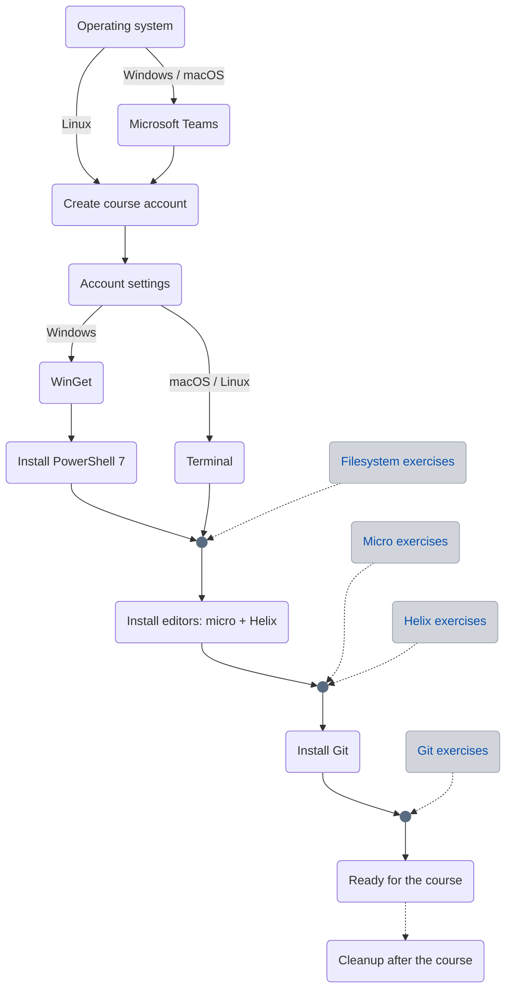

# Computer setup for practical courses

Create a separate standard user account and follow the guide for your operating system.

# Setup workflow

Exercises: [filesystem](https://github.com/python-edu/exercises/tree/main/filesystem) · [micro](https://github.com/python-edu/exercises/tree/main/micro) · [Helix](https://github.com/python-edu/exercises/tree/main/helix) · [Git](https://github.com/python-edu/git_intro/blob/main/git_basics.md)

# Guides

| Operating system | Guide |
|---|---|
| Windows 11 | [f01_new_account_windows11.md](f01_new_account_windows11.md) |
| Windows 10 | [f02_new_account_windows10.md](f02_new_account_windows10.md) |
| macOS | [f03_new_account_macos.md](f03_new_account_macos.md) |
| Debian / Ubuntu | [f04_new_account_linux.md](f04_new_account_linux.md) |
