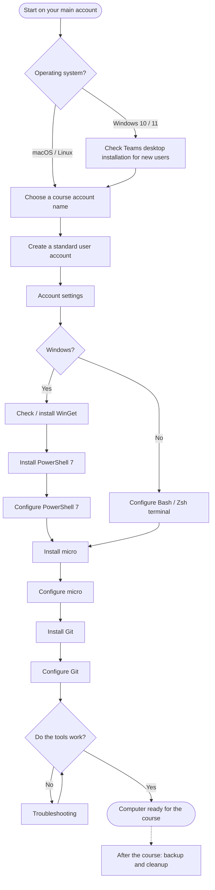

# Computer setup for practical courses

Prepare a separate standard user account and terminal tools for practical classes. Use the guide for your operating system.

---

# Contents

- [Setup workflow](#setup-workflow)
- [Guides](#guides)

---

# Setup workflow

---

# Guides

| File | Operating system |
|---|---|
| [f01_new_account_windows11.md](f01_new_account_windows11.md) | Windows 11 |
| [f02_new_account_windows10.md](f02_new_account_windows10.md) | Windows 10 |
| [f03_new_account_macos.md](f03_new_account_macos.md) | macOS |
| [f04_new_account_linux.md](f04_new_account_linux.md) | Debian / Ubuntu |
