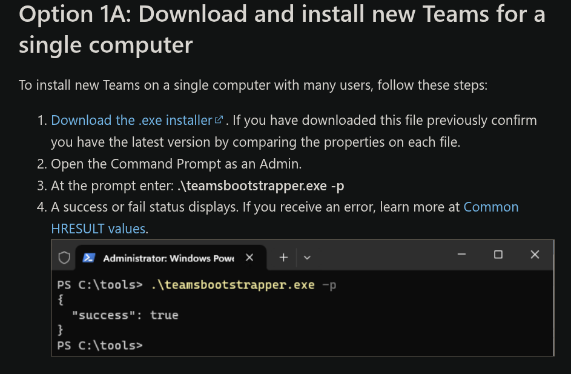
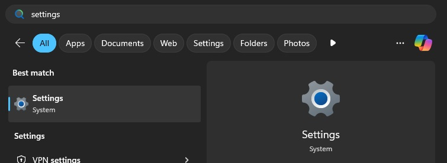
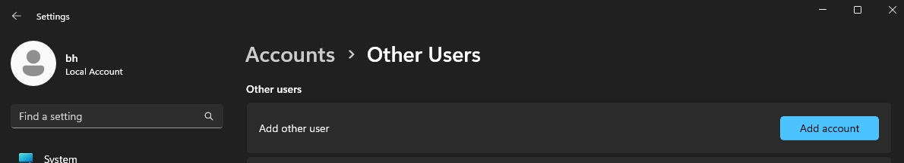
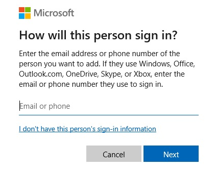
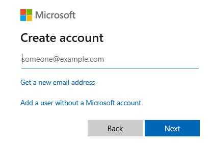

# Preparing Windows 11

---

# Contents

- [Microsoft Teams](#microsoft-teams)
- [New account](#new-account)
- [Account settings](#account-settings)
- [WinGet](#winget)
- [PowerShell 7 installation](#powershell-7-installation)
- [PowerShell 7 setup](#powershell-7-setup)
- [Micro installation](#micro-installation)
- [Micro setup](#micro-setup)
- [Git installation](#git-installation)
- [Git setup](#git-setup)
- [Troubleshooting](#troubleshooting)
- [Cleanup](#cleanup)

---

# Microsoft Teams

**Complete this section on your main administrator account, before creating the course account.**

1. Open **Windows PowerShell as administrator**.
2. Check whether the **Teams desktop application** is installed for future Windows accounts:

   ```powershell
   Get-AppxProvisionedPackage -Online | Where-Object DisplayName -eq "MSTeams"
   ```

3. Compare the result:

   **Teams is ready — `DisplayName : MSTeams` appears:**

   ```text
   DisplayName : MSTeams
   Version     : ...
   PackageName : ...
   ```

   Continue to [New account](#new-account).

   **Teams is not ready — nothing appears between the prompts:**

   ```text
   PS C:\Users\student> Get-AppxProvisionedPackage -Online | Where-Object DisplayName -eq "MSTeams"
   PS C:\Users\student>
   ```

   Perform steps 4–6 **before creating the course account**.

4. Download the latest `teamsbootstrapper.exe` using [Microsoft's Teams deployment instructions](https://learn.microsoft.com/en-us/microsoftteams/teams-client-bulk-install).
5. In the administrator PowerShell, run:

   ```powershell
   cd $HOME\Downloads
   .\teamsbootstrapper.exe -p
   ```

   

6. Confirm `"success": true`, then repeat step 2. Continue only when `DisplayName : MSTeams` appears.

---

# New account

On the **main administrator account**:

1. Press `Win + R`, type `winver`, press **Enter**.
   - Windows 11 versions include `24H2`, `25H2`, `26H2`.
   - `25H2` means the second half of 2025; the version can affect the location of settings.
2. Choose a name for the course account:

   **Account name:** `________________`

   Examples: `coding_lab`, `gis_lab`, `rs_lab`, `science_lab`.

3. Open **Settings**.

   

4. Open **Accounts → Other users → Add account**.

   

5. Select **I don't have this person's sign-in information**.

   

6. Select **Add a user without a Microsoft account**.

   

7. Enter your chosen account name and a password. Keep the account type **Standard user**.
8. Sign out and sign in to the new account.

---

# Account settings

## Set English as the account display language

  - Open Start → Settings (Win + I).
  - Select Time & language → Language & region.
  - Under Preferred languages, click Add a language.
  - Search for English (United States) and select Next.
  - Select Language pack and Set as my Windows display language. Other optional features are not required.
  - Click Install.
  - After installation, select Sign out when prompted.
  - Sign in again to the same account.


## Show file name extensions

  - Open **File Explorer**.
  - Select **View → Show → File name extensions**.
  - Enable **File name extensions**.


---

# WinGet

On the **new account**, open **Windows PowerShell**.

1. Check:

   ```powershell
   winget --version
   ```

   **Version appears**, for example `v1.x.x` → continue to [PowerShell 7 installation](#powershell-7-installation).

   **`winget` is not recognized** → continue to step 2.

2. Register WinGet for the newly created user:

   ```powershell
   Add-AppxPackage -RegisterByFamilyName -MainPackage Microsoft.DesktopAppInstaller_8wekyb3d8bbwe
   ```

3. Close PowerShell, reopen it and check:

   ```powershell
   winget --version
   ```

4. If `winget` is still missing, open [Microsoft App Installer](https://apps.microsoft.com/detail/9nblggh4nns1), install or update **App Installer**, reopen PowerShell and repeat step 3.

5. If App Installer cannot be installed, contact the computer administrator. Do not proceed to the WinGet installation commands without a working `winget`.

---

# PowerShell 7 installation

On the **new account**, in Windows PowerShell:

1. Install PowerShell 7:

   ```powershell
   winget install --id Microsoft.PowerShell --exact --source winget
   ```

2. Open **PowerShell 7** from the Start menu.
3. Check:

   ```powershell
   $PSVersionTable.PSVersion
   ```

   The **Major** version must be `7`.

**If the MSIX installation fails:**

1. Download the Windows ZIP for your processor from the [official PowerShell releases](https://github.com/PowerShell/PowerShell/releases).
2. In File Explorer, extract its contents to **`%LOCALAPPDATA%\Programs\PowerShell\7`**. This is a location inside your own Windows profile.
3. Open PowerShell and start the extracted program:

   ```powershell
   cd "$env:LOCALAPPDATA\Programs\PowerShell\7"
   .\pwsh.exe
   ```

---

# PowerShell 7 setup

On the **new account**, in PowerShell 7:

1. Allow local scripts:

   ```powershell
   Set-ExecutionPolicy -ExecutionPolicy RemoteSigned -Scope CurrentUser
   Get-ExecutionPolicy
   ```

   Confirm if prompted. The second command should return `RemoteSigned`.

2. Check that `pwsh` is available as a command:

   ```powershell
   Get-Command pwsh
   pwsh --version
   ```

3. If `pwsh` is not recognized after installing from ZIP, add **`%LOCALAPPDATA%\Programs\PowerShell\7`** to your user `Path`:
   - Press **Win**, type **Edit environment variables for your account**, open it.
   - Under **User variables**, choose **Path → Edit → New**.
   - Paste `%LOCALAPPDATA%\Programs\PowerShell\7` and confirm with **OK**.
   - Open a new PowerShell window and repeat step 2.

4. In **Windows Terminal → Settings → Profiles → PowerShell 7 → Starting directory**, select your home directory (`%USERPROFILE%`).

---

# Micro installation

On the **new account**, in PowerShell 7:

1. Install [micro](https://github.com/micro-editor/micro):

   ```powershell
   winget install --id zyedidia.micro --exact --source winget
   ```

2. Open a new PowerShell 7 window and check:

   ```powershell
   micro -version
   ```

**If the WinGet installation fails:**

1. Download the Windows ZIP from [micro releases](https://github.com/micro-editor/micro/releases).
2. Extract `micro.exe` to **`%LOCALAPPDATA%\Programs\micro`**.
3. Add this directory to your **user `Path`** using the procedure in [PowerShell 7 setup](#powershell-7-setup), step 3 (substitute the micro directory).
4. Open a new PowerShell window and run `micro -version`.

---

# Micro setup

On the **new account**, in PowerShell 7:

1. Open the editor:

   ```powershell
   micro
   ```

2. Press **Ctrl+E** to open the command bar at the bottom.
3. Enter the following commands **one at a time**, pressing **Enter** after each line:

   ```text
   set tabsize 4
   set tabstospaces true
   set tabmovement true
   set autoindent true
   set smartpaste false
   set clipboard external
   set syntax true
   set matchbrace true
   set hltrailingws true
   set colorcolumn 80
   set hlsearch true
   bind Alt-s SaveAs
   ```

   - `tabsize 4` – four spaces per indentation level.
   - `tabstospaces true` – insert spaces instead of tab characters.
   - `tabmovement true` – move the cursor across indentation in groups of four spaces.
   - `autoindent true` – preserve indentation while typing.
   - `smartpaste false` – do not add extra indentation when pasting.
   - `clipboard external` – use the Windows clipboard.
   - `syntax true` – highlight code syntax.
   - `matchbrace true` – highlight matching brackets.
   - `hltrailingws true` – highlight trailing whitespace at the end of lines.
   - `colorcolumn 80` – display a vertical guide at column 80.
   - `hlsearch true` – highlight all search matches.
   - `bind Alt-s SaveAs` – assign **Alt+S** to Save As (**Ctrl+S** remains Save).


4. Press **Ctrl+Q** to close micro. The settings are saved for this account.
5. Configure **Windows Terminal** to let micro handle **Ctrl+V** itself:
   - Open **Windows Terminal → Settings → Actions**.
   - Find the **Paste** action assigned to **Ctrl+V**.
   - Remove **Ctrl+V** from that terminal action (keep **Ctrl+Shift+V** for terminal pasting).
   - Save the terminal settings.
   - When editing in micro, paste with **Ctrl+V**.

6. Set `micro` **permanently** as the default editor for this Windows account:

   ```powershell
   [Environment]::SetEnvironmentVariable('EDITOR', 'micro', 'User')
   ```

   This saves `EDITOR=micro` in the **user environment variables**, including for future terminal sessions. No administrator permissions are needed.

7. **Close PowerShell 7 and open a new window**, then confirm:

   ```powershell
   $env:EDITOR
   ```

   Expected output:

   ```text
   micro
   ```

---

# Git installation

On the **new account**, in PowerShell 7:

1. Check whether Git is already available:

   ```powershell
   git --version
   ```

   - If `git version ...` appears, Git is available to this account, even if it was installed earlier for all Windows users. Continue to [Git setup](#git-setup). The Git settings in the next section will belong to the **new account**.
   - If Windows reports that `git` is not recognized, continue to step 2.

2. Install Git for the current user:

   ```powershell
   winget install --id Git.Git --exact --scope user --source winget
   ```

3. Open a **new PowerShell 7** window and run:

   ```powershell
   git --version
   ```

   If a version appears, continue to [Git setup](#git-setup).

**If WinGet cannot install Git for this account:**

1. Open [Git for Windows](https://git-scm.com/install/win).
2. Under **Portable ("thumbdrive edition")**, download the **x64 Portable** release (or ARM64 on an ARM computer). The file name begins with `PortableGit-` and ends in `.7z.exe`.
3. Open **File Explorer → Downloads** and **double-click the downloaded `.7z.exe` file**. It is a self-extracting archive; no additional archiving program is needed.
4. In the window asking for the extraction folder:
   - Press **Win+R**, type `%LOCALAPPDATA%\Programs` and press **Enter**. Windows opens your own local programs directory.
   - Copy its full address from the File Explorer address bar and append `\Git` (for example, `C:\Users\coding_lab\AppData\Local\Programs\Git`).
   - Paste this **full path** into the archive's destination field and start extraction. The `Git` folder will be created there.
5. Check that the extracted folder contains the file `cmd\git.exe` (inside the `Git` folder).
6. Add Git to your **user `Path`**:
   - Press **Win** and search for **Edit environment variables for your account**.
   - Select **Path** under **User variables**, then **Edit → New**.
   - Enter `%LOCALAPPDATA%\Programs\Git\cmd`.
   - Confirm by clicking **OK** in all open dialogs. Do not change **System variables**.
7. Close PowerShell 7, open a new window and check:

   ```powershell
   git --version
   ```

---

# Git setup

On the **new account**, replace the example name and email:

```powershell
git config --global user.name "Name Surname"
git config --global user.email "your-address@example.com"
git config --global core.editor micro
git config --global init.defaultBranch main
```

Other editor choices (use **one** instead of `micro`):

```powershell
git config --global core.editor nvim
git config --global core.editor vim
git config --global core.editor notepad
```

Check:

```powershell
git config --global --list
```

---

# Troubleshooting

## 1. Check the account

1. Open PowerShell:

   ```powershell
   whoami
   $HOME
   ```

2. `whoami` displays the account you are using. `$HOME` displays that account's home directory.
3. If these show your main account, sign out and log in to the new course account before continuing.

## 2. `pwsh` is not recognized

1. Open **Start** and search for **PowerShell 7**.
2. If you installed PowerShell from ZIP, open **File Explorer**, then enter `%LOCALAPPDATA%\Programs\PowerShell\7` in the address bar.
3. Check whether `pwsh.exe` is present.
4. If the file exists, follow [PowerShell 7 setup](#powershell-7-setup), step 3, to add this directory to your **user `Path`**.
5. Close PowerShell, open a new window and check:

   ```powershell
   pwsh --version
   ```

## 3. PowerShell opens in `C:\Windows\System32`

1. Open **Windows Terminal → Settings → Profiles → PowerShell 7**.
2. Set **Starting directory** to `%USERPROFILE%`.
3. Open a new terminal and check:

   ```powershell
   pwd
   ```

## 4. `micro` or `git` is not recognized

1. Close PowerShell 7 and open a new window.
2. Check the program:

   ```powershell
   micro -version
   git --version
   ```

3. If micro was extracted from ZIP, check for `micro.exe` in `%LOCALAPPDATA%\Programs\micro`.
4. If PortableGit was extracted, check for `git.exe` in `%LOCALAPPDATA%\Programs\Git\cmd`.
5. Add the corresponding folder to your **user `Path`** using [PowerShell 7 setup](#powershell-7-setup), step 3.
6. Open a new PowerShell 7 window and repeat step 2.

## 5. Pasting in micro changes indentation

1. Open micro and press **Ctrl+E**.
2. Enter `set smartpaste false` and press **Enter**.
3. Check **Windows Terminal → Settings → Actions**: **Ctrl+V** must not be assigned to the terminal's **Paste** action.
4. In micro, use **Ctrl+V** to paste using micro's clipboard command.

## 6. Account creation or app installation is blocked

1. Return to the main administrator account to create the new local user.
2. Open **Settings → Accounts → Other users** and check whether that user already exists.
3. If Windows reports that an administrator or organization blocks the action, contact the computer administrator.

---

# Cleanup

If you want to clean up the computer after the course:

1. Copy any files you want to keep from the course account to your main account or another safe location.
2. Sign out of the course account.
3. Sign in to the main administrator account.
4. Open **Settings → Accounts → Other users**.
5. Select the course account you created and choose **Remove → Delete account and data**.

